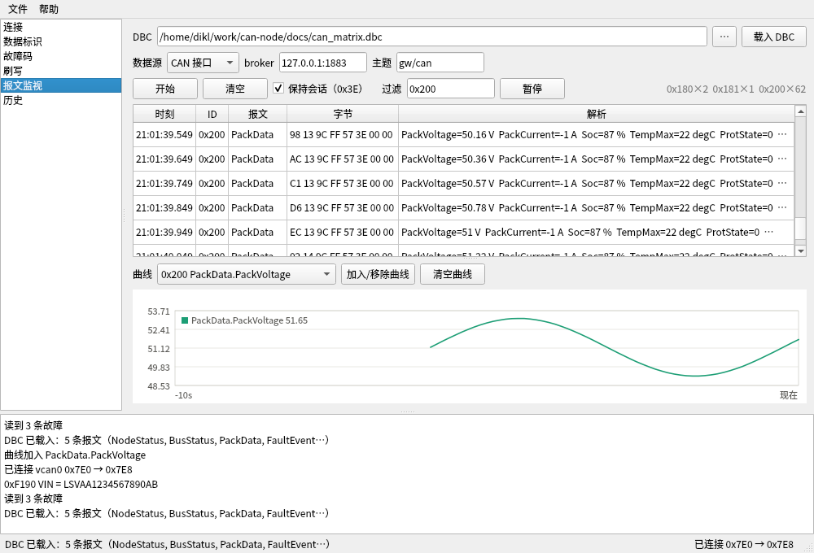
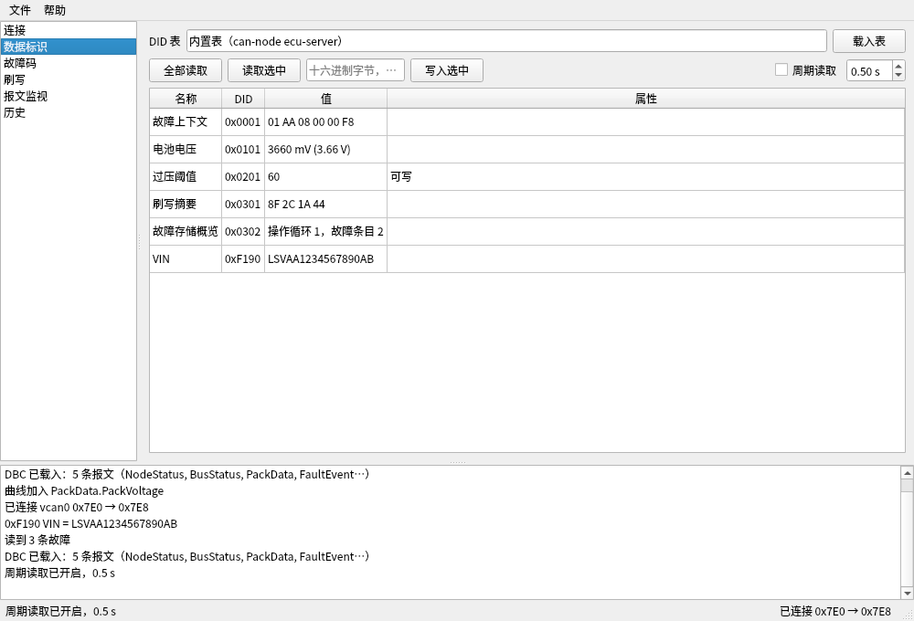
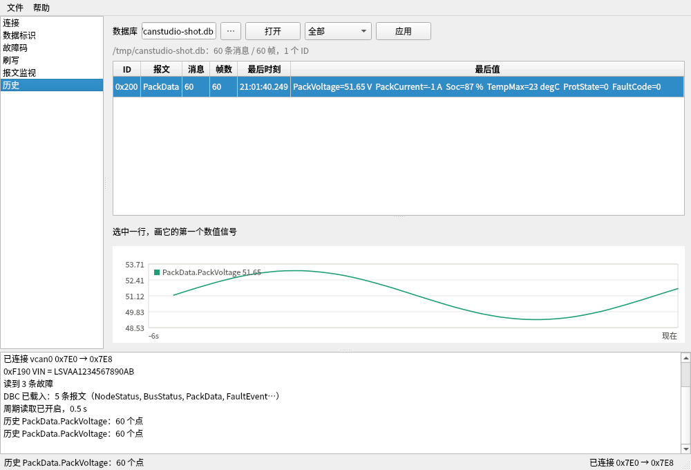

# can-studio

CAN / UDS 诊断上位机。面向 [can-node](https://github.com/Dik-910/can-node) 的
诊断服务与 Bootloader，也适用于任何遵守 ISO 14229 的 ECU。

分为四层，界面只依赖下面三层：

```
canstudio/link.py    链路：把「发一帧、等一帧」抽象出来（SocketCAN / 假链路）
canstudio/uds.py     协议：ISO 14229 请求编码、响应解码、否定响应与 0x78 处理
canstudio/dtc.py     语义：故障码、状态位、快照的解读
canstudio/flash.py   流程：0x34/36/37 编排、重试、进度、CRC 交叉校验
canstudio/signals.py 语义：按 DBC 把 CAN 帧解成信号值
canstudio/uplink.py  数据源：订阅网关的 MQTT 上行，还原成帧
canstudio/history.py 存储：上行报文落 SQLite，供历史与统计查询
gui/                 界面：五页 Qt 窗口，只调用上面四层，不含协议编码
```

这样分层的原因：协议层要能脱离硬件测试。`tests/` 里用假链路把整套服务跑一遍，
否定响应、0x78 挂起、超时、回显不匹配这些情况都能精确构造出来，不必在真实
总线上撞运气。

## 当前状态

| 模块 | 状态 |
|---|---|
| `canstudio/link.py` | 已实现：SocketCAN + ISO-TP、RecordingLink（记录收发） |
| `canstudio/uds.py` | 已实现：`0x10/11/14/19/22/27/2E/31/34/36/37/3E` |
| `canstudio/dtc.py` | 已实现：DTC 编解码、状态位、快照解析（0x19 六个子功能） |
| `canstudio/dids.py` | 已实现：DID 表与解码，未知 DID 按原始字节展示 |
| `canstudio/flash.py` | 已实现：HEX/S-record 解析、分块、序号回绕、重试、CRC 交叉校验 |
| `canstudio/signals.py` | 已实现：DBC 载入与帧解码，未知报文不中断监视 |
| `canstudio/uplink.py` | 已实现：MQTT 上行订阅与解析（聚合报文还原成帧） |
| `canstudio/history.py` | 已实现：SQLite 落库、批量提交、按 ID 汇总与序列查询 |
| `cli.py` | 已实现：会话、DID 读写、故障码、刷写、原始请求、监视 |
| `gui/` | 已实现：连接、DID、故障码、刷写、报文监视五页（PySide6） |

测试 205 项，全部不依赖 CAN 接口与显示器。

## 界面







左栏五个功能页，底部是操作日志，状态栏显示当前连接。所有耗时操作都走后台
线程，界面不会因为一次 P2 超时而假死。

监视页是截图里那页：它是**原始帧监视**，不是 UDS 报文列表 —— 单独开一个
SocketCAN 套接字，所以能看到总线上真实流动的周期帧（ISO-TP 那条链路会
把帧消费掉）。载入 DBC 后，`0x200` 直接显示为
`PackVoltage=51.12 V  PackCurrent=-1 A  Soc=87 %`，而不是十六进制字节。

```bash
./cli.py monitor --dbc ../can-node/docs/can_matrix.dbc --id 0x180
```

时刻带毫秒。只到秒的话，20 ms 与 100 ms 两种周期在表里看起来一样 ——
一眼看不出哪条报文快。右下角按 ID 累计帧数，比例就是这个周期比
（0x180 : 0x181 = 1 : 5）。

帧率高的时候需要筛：0x181 每 20 ms 一帧，0x180 每 100 ms，不筛会被淹掉。
过滤框接受 `0x180 0x181`、`180,181` 这类写法，留空显示全部。
「暂停」只停止插入新行，采集继续；恢复时会告诉你在暂停期间到达了多少帧。

DID 页支持周期读取：勾上「周期读取」并设定间隔，表格按拍刷新；两次之间
值发生变化时会在日志里点出来。命令行等价物是 `did watch`：

```bash
./cli.py did watch --did-table config/dids.json --interval 1
```

## 网关后面怎么看总线状态

站在网关后面时，**总线上的周期帧是看不到的**：网关只转发诊断流量，
不会把整条总线复制到另一侧（`can-gateway` 的 `system.conf` 就是这么配的，
实测确认）。要在这种拓扑下看「节点状态 / 总线状态」，只能读网关的 MQTT 上行。

监视页的数据源选「网关 MQTT」，或命令行：

```bash
./cli.py monitor --mqtt --dbc ../can-node/docs/can_matrix.dbc
```

上行格式（`can-gateway` 的 `route_engine.c:on_agg_export`）：

```json
{"gw":"can-gateway","ch":"vcan1","id":"0x181","n":101,"dlc":8,"d":"0000000000000000","ts":123456789}
```

`n` 是这窗口里聚合到的帧数，所以表格里显示成 `BusStatus ×101`。
这个数字能反过来校验周期：0x180 每 100 ms 一帧，1 秒窗口应当是 ×10。

实测（节点在 vcan1、网关、上位机读 MQTT）：

```
0x180  NodeStatus  ×10  NodeState=1  ErrLevel=0  BusOffCnt=0  UptimeS=4 s
0x181  BusStatus   ×101 Tec=0  Rec=0  BusLoadPermille=0 permille
```

注意 `ts` 是网关的单调时钟毫秒，不是墙上时间，所以表格显示的是收到消息的
本地时刻，`ts` 只留给排查用。

## 诊断穿网关

诊断报文不聚合，走 `[diag]` 映射逐帧转发。多帧响应（`0x19` 读码、`0x22` 读
长 DID）能不能通，取决于网关有没有把 tester 的**流控帧**也转过去 —— 只转发
请求和响应、漏掉 `FC` 的实现，单帧服务全好，多帧一律超时。

实测（tester 在 vcan0，节点在 vcan1，中间一道网关，`0x19 0A` 回 3 条码 = 15 字节）：

```
0x7E0  02 19 0A AA...         tester 请求（单帧）
0x7E8  10 0F 59 0A FF ...     节点首帧，声明总长 15
0x7E0  30 08 05 AA...         tester 流控：块大小 8、STmin 5ms
0x7E8  21 00 C0 02 87 ...     连续帧 1
0x7E8  22 87 00               连续帧 2
```

三个方向都在：请求 a→b、响应 b→a、流控 a→b。`dtc list` / `dtc supported`
在网关后面同样可用。

刷写穿网关也实测过（`ecu-server` 接 vcan1，tester 在 vcan0）：

```
固件 2048 字节 / 9 块，0.06 s
CRC 校验通过：0xB9D45861
tester 侧收帧: {0x7e0: 309, 0x7e8: 28}
```

9 块 × 每块一个多帧传输（`0x36` 带 254 字节 → 1 个首帧 + 36 个连续帧），
两个方向合计 337 帧在 60 ms 内穿完网关，顺序与流控都没乱。

## 落库与历史

网关上报的是**变化量**：数值不变就不报。所以实时页面看到的是「最近一次变化」，
看不到「过去一小时电压怎么走的」。落库之后才有历史、统计和趋势。

```bash
./cli.py record --db gateway.db --hours 24      # 订阅上行并落库，只留最近 24 小时
./cli.py history --db gateway.db --hours 1      # 按 ID 汇总
./cli.py history --db gateway.db --id 0x200 --dbc ../can-node/docs/can_matrix.dbc
```

界面里「历史」页读同一个库：按时间窗筛选、选中一行就把它的历史画成曲线。

实测（节点 vcan1 + 网关 + 落库 8 秒）：

```
gateway.db（全部）：9 条消息，361 帧

ID       报文                 消息       帧数  最后值
0x180  NodeStatus          6       60  NodeState=1 ErrLevel=0 BusOffCnt=0 UptimeS=8 s
0x181  BusStatus           3      301  Tec=0 Rec=0 BusLoadPermille=0 permille
```

**「消息数」和「帧数」是两个概念**，必须分开存：网关把 500 ms 窗口内的帧聚合成
一条消息，0x181 一条消息可能代表 101 帧。只存消息数会把总线的实际负载算少两个
数量级，所以表里 `n` 单独一列，`SUM(n)` 才是「总线上出现过多少帧」。

## DID 表

DID 表跟着 ECU 走，所以它是配置而不是代码。默认表在 `config/dids.json`，
与内置表一致（有用例守着，两者不会悄悄分叉）。

```json
{
  "ecu": "can-node ecu-server",
  "dids": [
    {"id": "0xF190", "name": "VIN", "length": 17, "decode": "ascii"},
    {"id": "0x0101", "name": "电池电压", "length": 2, "decode": "millivolt"},
    {"id": "0x0201", "name": "过压阈值", "length": 1, "decode": "uint8",
     "writable": true, "session": "extended"}
  ]
}
```

`decode` 可选：`ascii` / `hex` / `millivolt` / `dtc_stats`，以及
`uint8` `uint16` `uint32` `int8` `int16` `int32`（可带 `scale` 与 `unit`）。
数值一律按**大端**解 —— UDS 用网络字节序，与 DBC 常见的 Intel 小端相反，
弄反会得到完全错误的数字。

`id` 支持 `"0xF190"` / `"F190"` / `61712`；`session` 支持 `"default"` /
`"extended"` / `"programming"`。解码方式写错不会让整张表失效，回落到
十六进制显示。

界面里「载入表」换一张；命令行加 `--did-table <path>`。载入失败时保留原表，
不会把界面刷成空的。

```bash
./studio.py          # 图形界面
make shot            # 离屏重新渲染截图（无显示器也能出图）
```

界面测试用 `QT_QPA_PLATFORM=offscreen` 真跑事件循环：构造窗口、注入假 ECU、
点按钮，断言表格被填写。这样界面代码不是「写完没跑过」。

## 用法

```bash
./cli.py did read VIN 0x0101 0x0302
./cli.py did write 0x0201 3C
./cli.py dtc list
./cli.py dtc snapshot --record 1
./cli.py dtc clear
./cli.py flash build/app.hex
./cli.py raw 22 F1 90
./cli.py monitor
```

默认对准 `vcan0`、请求 `0x7E0`、响应 `0x7E8`，与 can-node 的 `ecu-server` 一致。
换 ECU 用 `--if / --tx / --rx`，换密钥算法用 `--key-file`（文件里定义
`key_algo(level, seed, params)`）。

```
$ ./cli.py did read VIN 0x0101 0x0302
0xF190  VIN          LSVAA1234567890AB
0x0101  电池电压      3660 mV (3.66 V)
0x0302  故障存储概览   操作循环 1，故障条目 0
```

`0x0201` 是可写的过压阈值，写入要先切扩展会话再解锁，这一条同时验证了
会话控制、安全访问与写服务：

```
$ ./cli.py did write 0x0201 3C
0x0201 过压阈值 写入成功（1 字节）
$ ./cli.py did read 0x0201
0x0201  过压阈值       60
```

## 实测

对接 `can-node` 的 `ecu-server`（vcan0，请求 0x7E0 / 响应 0x7E8）：

| 命令 | 结果 |
|---|---|
| `did read VIN 0x0101 0x0302` | VIN 17 字节走多帧读回、电压解出 3.66 V、故障概览解出循环与条目数 |
| `did write 0x0201 3C` → `did read 0x0201` | 写入 60 并读回一致（需扩展会话 + 安全访问） |
| `dtc list` | 无故障 |
| `dtc supported` | `U010087 0xC10087` |
| `raw 22 F1 90` | 原始响应 `62 F1 90 4C 53 56 41 ...` |
| `flash fw.hex -y` | 2048 字节 / 9 块 / 0.05 s，ECU 侧算出的 CRC32 与本机一致 |
| `monitor --dbc can_matrix.dbc` | `0x200` 解为 `PackVoltage=51.12 V  PackCurrent=-1 A  Soc=87 %  TempMax=25 degC` |
| `monitor`（对真实节点） | `0x180 NodeStatus  NodeState=1  ErrLevel=0  BusOffCnt=0  UptimeS=4 s`，0x181 每 20 ms、0x180 每 100 ms 刷新 |
| 界面监视页（对真实节点） | 离屏加载界面连 vcan0，抓到 6 帧并解出 `NodeStatus` / `BusStatus` |

监视页拿到真实帧时的输出（DBC 用 can-node 的 `docs/can_matrix.dbc`）：

```
DBC .../can_matrix.dbc：5 条报文
0x180  NodeStatus   NodeState=2  ErrLevel=1  BusOffCnt=4660  UptimeS=412 s
0x200  PackData     PackVoltage=51.12 V  PackCurrent=-1 A  Soc=87 %  TempMax=25 degC
0x181  BusStatus    Tec=0  Rec=0  BusLoadPermille=153 permille
```

三种编码都被覆盖到：无符号（`BusOffCnt=0x1234`）、有符号（`PackCurrent=-1 A`）、
带偏移（`TempMax` 原始 65 减去 40）。

刷写的输出：

```
固件 fw.hex: 0x08000000..0x08000800  2048 字节  crc32 0xB9D45861
  [#########################] 100%  2048/2048
完成：2048 字节 / 9 块，0.05 s
CRC 校验通过：0xB9D45861
```

## 协议细节

几处实现上容易错、且已经写进代码注释的地方：

**`0x34` 的两个 ALFID 不是一回事。** 请求里 `ALFID = 0x44`，高半字节是地址
字节数、低半字节是长度字节数；响应里高半字节才是 `maxNumberOfBlockLength` 的
字节数。两个方向混用，块大小会算成 0 或者超长。另外这个长度包含 SID 与块序号
两字节，真正能装的数据要减 2。

**`0x78` 不是失败。** ECU 回 `7F xx 78` 表示「在处理」，此时要按 P2\* 重新计时
继续等，既不能重发请求，也不能判超时。

**DTC 文本固定 6 位十六进制。** `0xC10087` 显示为 `U010087`，不省前导零：
`U10087` 这种 5 位写法与 2 字节 DTC 的 4 位写法混在一起就分不清了。解析时
两种写法都接受，现场手抄的码常漏零。

## 测试

```bash
make test      # 54 项，verbosity=2
make check     # 只报结果
```

用例覆盖的是请求编码与响应解码本身：`0x10 03` 是否原样发出、`0x27` 的种子
如何算成密钥、`74 20 02 00` 是否解析出 512 字节的块长、0x19 各子功能的响应
是否按标准切开。

## 对接 ECU 的前提

- CAN 接口就绪：`sudo modprobe vcan && sudo ip link add dev vcan0 type vcan && sudo ip link set up vcan0`
- ECU 侧在跑：`cd ../can-node && ./ecu-server --if vcan0`
- ID 与 can-node 一致：请求 `0x7E0`、响应 `0x7E8`

DID 表与密钥算法都按 can-node 的 `ecu-server` 定义（`canstudio/dids.py`
与 `uds.default_key_algo`）。换 ECU 时改这两处，协议层不用动。

## 相关仓库

| 仓库 | 关系 |
|---|---|
| [can-node](https://github.com/Dik-910/can-node) | 被诊断的 ECU 节点固件，本工具的对接目标 |
| [can-gateway](https://github.com/Dik-910/can-gateway) | 车载 CAN 网关，可在本工具与 ECU 之间转发 |
| [bms-node](https://github.com/Dik-910/bms-node) | 储能 BMS 节点，复用同一套 UDS 服务端 |
| [mcu-gateway](https://github.com/Dik-910/mcu-gateway) | Modbus/RS485 网关，另一条链路 |

## 许可证

MIT

## 参考的同类项目

协议与界面都不必从零设计，几个公开项目的做法有直接借鉴价值：

| 项目 | 借鉴的点 |
|---|---|
| [UDT](https://github.com/hmf1235789/UDT) | 按 `core / transports / services / gui` 分包，服务用注册表扩展 |
| [UDS_Python_Prj](https://github.com/teddy1122/UDS_Python_Prj) | 刷写上位机的完整流程：固件文件解析 → ISO-TP → UDS 传输服务 |
| [uds_tracer](https://github.com/aslansq/uds_tracer) | 报文监视界面的信息组织（时间、方向、原始帧、解析结果） |
| [python-can](https://github.com/hardbyte/python-can) | `can.viewer` 的后台收帧方式与界面骨架 |
| [cantools](https://github.com/cantools/cantools) | DBC 解码，监视页按信号名展示而非裸字节 |

本仓库的取舍：协议层自己实现（这样两侧实现独立，互操作测试才有意义），
界面层用 PySide6（官方绑定，LGPL，与 MIT 兼容；PyQt5 是 GPL，不能与 MIT 混用），
固件文件解析用 `bincopy`（Intel HEX 与 S-record 的格式细节不必自己维护）。

## 依赖

| 用途 | 包 | 说明 |
|---|---|---|
| 链路 | `python-can`, `can-isotp` | 只在 `SocketCanLink` 里按需 import |
| 固件文件 | `bincopy` | Intel HEX / S-record 解析 |
| 界面 | `PySide6-Essentials` | LGPL，与 MIT 兼容 |

```bash
pip install python-can can-isotp bincopy PySide6-Essentials
```

测试只依赖标准库：假链路代替 SocketCAN，离屏后端代替显示器。

## 本地跑起来看实时通信

三步，都在同一台机器上：

```bash
# 1. 建虚拟总线（重启后要重建，vcan 是运行时接口）
sudo modprobe vcan
sudo ip link add dev vcan0 type vcan && sudo ip link set up vcan0

# 2. 让总线上有真实流量：can-node 的节点程序每 100ms 发 0x180、每 20ms 发 0x181
cd ../can-node && make node && ./node --if vcan0

# 3. 开上位机
cd ../can-studio && ./studio.py
```

界面里连 `vcan0`（0x7E0 / 0x7E8），然后：

- **报文监视**：点「开始」，能看到 `0x180 NodeStatus` 与 `0x181 BusStatus`
  按周期刷新，`NodeState`、`BusOpCnt`、`UptimeS`、`Tec`/`Rec` 由 DBC 解出
- **数据标识**：点「全部读取」读 VIN 与电压；勾「周期读取」看电压跳动

没有 PySide6 也可以只用命令行：`./cli.py monitor --dbc ../can-node/docs/can_matrix.dbc`。

一个诊断地址对（`0x7E0` / `0x7E8`）同一时刻只能有一个 tester：界面已经连上时，
再从命令行发诊断请求会互相抢响应。看报文不受影响（监视是独立套接字、只收不发），
但界面和命令行别同时做诊断。
